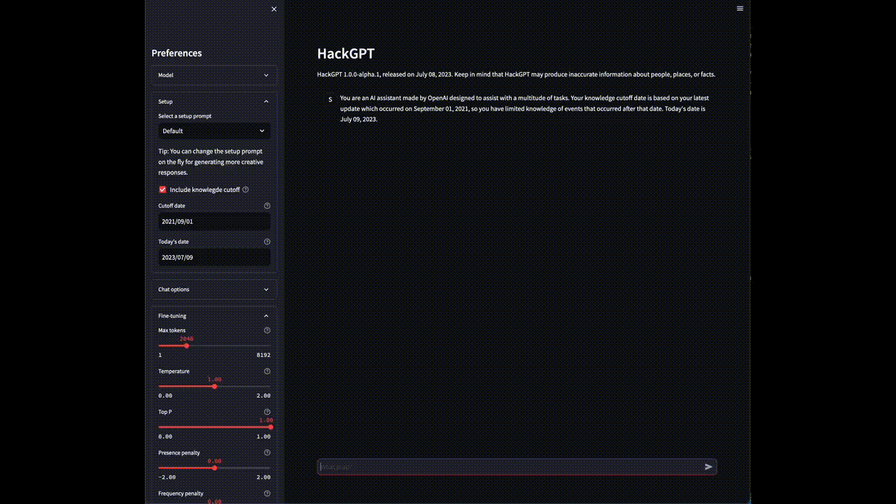

# HackGPT

HackGPT is a Streamlit chat interface with provider-neutral model discovery,
streaming, setup prompts, and schema-driven generation controls.

[](./static/images/demo.gif)

## Features

- **Multiple providers**: Use OpenAI, Anthropic Claude, or Ollama without changing
  the chat interface.
- **Dynamic model discovery**: The model picker reflects the models available to
  the configured account or Ollama host. Models can be refreshed from the sidebar.
- **Capability-aware configuration**: Every model supplies its own typed option
  schema, including defaults, ranges, choices, and conditional fields. Unsupported
  controls are never sent to a provider.
- **Provider-neutral chat**: Text history and system prompts remain usable when
  switching between compatible providers and models.
- **Streaming responses**: All provider adapters stream response text into the
  existing chat interface.
- **Setup prompts and historical context**: Select a bundled or custom setup prompt
  and optionally add a validated historical knowledge cutoff.

The capability model already represents streaming, system prompts, tools,
structured output, image input, and reasoning. Adding UI for future capabilities
does not require provider-specific branches in the generic option renderer.

## Provider configuration

Credentials and endpoints are read only from environment variables. They are not
entered or displayed in the Streamlit interface.

| Provider | Required | Optional |
| --- | --- | --- |
| OpenAI | `OPENAI_API_KEY` | `OPENAI_BASE_URL`, `OPENAI_MODEL_ALIASES` |
| Anthropic | `ANTHROPIC_API_KEY` | `ANTHROPIC_BASE_URL` |
| Ollama | A reachable Ollama service | `OLLAMA_HOST`, `OLLAMA_API_KEY` |

Copy the example file and fill in only the providers you use:

```bash
cp .env.example .env
```

Docker Compose reads the root `.env` file automatically. For a local Python run,
export the variables into the process environment before starting Streamlit. If
`OLLAMA_HOST` is omitted, the Ollama client uses its local default. When Streamlit
runs in a container and Ollama runs on the host, set `OLLAMA_HOST` to an address
reachable from that container.

Provider availability is account- and deployment-specific. A configured provider
can still report a clear discovery error when credentials are invalid, its endpoint
is unreachable, or it has no compatible chat models.

### OpenAI models and compatible gateways

The OpenAI adapter uses `/models` for discovery and streams `/responses`.
Its GPT-6 profiles were checked against official OpenAI documentation on
2026-11-06:

| Model | Reasoning effort choices | Maximum output tokens |
| --- | --- | --- |
| `gpt-6-astra`, `gpt-6.1-sol` | `low`, `medium`, `high`, `xhigh`, `max` | 128,000 |
| `gpt-6-sol`, `gpt-6-luna`, `gpt-6.1-terra` | `none`, `low`, `medium`, `high`, `xhigh`, `max` | 128,000 |

All profiles default to `medium` effort and expose `standard`/`pro` reasoning mode
and `low`/`medium`/`high` verbosity. Sampling controls (`temperature`, `top_p`)
appear and are sent only when the model supports and selects `none`. Switching
back to reasoning omits stale sampling values. The existing GPT-4.1 sampling and
GPT-5.6 reasoning controls remain available.

The adapter translates `max_tokens` to `max_output_tokens`, effort and pro mode
to `reasoning`, and verbosity to `text.verbosity`. The output budget includes
reasoning tokens; the application default remains 2,048, so increase it for
reasoning-heavy answers. See [Using GPT-6](https://developers.openai.com/api/docs/guides/latest-model),
[model specifications](https://developers.openai.com/api/docs/models), and
[reasoning token budgets](https://developers.openai.com/api/docs/guides/reasoning).

Known profiles also cover date-suffixed snapshots and IDs prefixed with `openai/`.
For arbitrary LiteLLM aliases or Azure deployment names, configure an explicit,
single-level mapping to the underlying OpenAI model:

```bash
export OPENAI_BASE_URL=https://your-gateway.example/v1
export OPENAI_MODEL_ALIASES='{"team-reasoner":"gpt-6.1-sol","azure/team-chat":"gpt-6-luna"}'
```

Mappings select the local capability schema; requests keep the exact discovered
deployment ID. A mapping does not add a model absent from `/models`. Names outside
the OpenAI chat-model naming patterns are excluded unless mapped. Unverified
GPT-6 variants expose only the output budget
with a conservative 32,768 ceiling and use server defaults for other controls.
Configure aliases only for deployments with the stated model's capabilities.

The gateway must support streaming Responses requests and the selected controls;
Chat Completions compatibility alone is insufficient. LiteLLM may translate
Responses to Chat Completions for some backends, approximating or dropping
Responses-only fields. Check the deployment's endpoint configuration, including
native Responses passthrough where appropriate. See
[LiteLLM Responses passthrough](https://docs.litellm.ai/docs/response_api_native_passthrough).
Gateway regression tests use the real OpenAI SDK with mocked HTTP and SSE; they
do not certify a particular running gateway or account.

## Getting started

HackGPT requires Python 3.12 or newer.

### Docker Compose

```bash
docker compose -f docker/docker-compose.dev.yml up
```

Stop or remove the development service with:

```bash
docker compose -f docker/docker-compose.dev.yml stop
docker compose -f docker/docker-compose.dev.yml down
```

### Local development

```bash
python -m pip install -r requirements-dev.txt
streamlit run src/app.py
```

### VS Code Dev Container

Choose **Dev Containers: Reopen in Container** from the Command Palette. The
container installs the development requirements, forwards port 8501, and runs the
`HackGPT: Start Streamlit` workspace task when the folder opens. Its dedicated
integrated terminal is revealed automatically so startup messages, request logs,
and errors remain visible. The forwarded app also opens in a VS Code preview.

Use `Ctrl+C` in that terminal to stop Streamlit. To start it again, run
**Tasks: Run Task** and select `HackGPT: Start Streamlit`. After changing
`.devcontainer/devcontainer.json`, use **Dev Containers: Rebuild and Reopen in
Container** so the updated container settings take effect.

## Quality checks

Run the complete local verification suite from the repository root:

```bash
ruff format --check src tests
ruff check src tests
mypy src tests
pytest
```

## Architecture

- `src/app.py` — Streamlit entry point and provider-registry lifetime.
- `src/hackgpt/providers/types.py` — provider protocol, capabilities, option schemas,
  normalised messages, validation, and user-facing provider errors.
- `src/hackgpt/providers/` — isolated OpenAI, Anthropic, and Ollama adapters plus the
  provider registry.
- `src/hackgpt/ui/options.py` — generic schema-to-Streamlit widget rendering.
- `src/hackgpt/ui/sidebar.py` — provider/model discovery and application controls.
- `src/hackgpt/ui/chat.py` — provider-neutral history and streamed chat rendering.
- `src/hackgpt/prompts.py` — bundled setup-prompt loading and historical context.
- `src/hackgpt/state.py` — session-state initialisation and history normalisation.
- `tests/` — schema, selection, adapter translation, state, and Streamlit smoke tests.

## License

This project is licensed under the terms of the ISC license. See [LICENSE](LICENSE)
for details.
